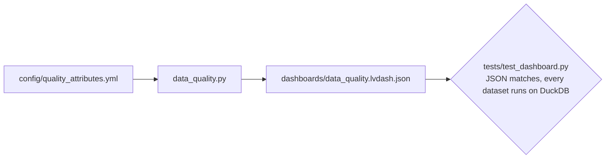

# Dashboard generators

Code that writes the AI/BI dashboard JSON under [`dashboards/`](../../dashboards/README.md), so the dashboard is reviewed as code and tested like the rest of the pipeline.

| Module | Writes | From |
|---|---|---|
| `data_quality.py` | `dashboards/data_quality.lvdash.json` | `config/quality_attributes.yml` and the control tables' columns |

```bash
python -m src.dashboard.data_quality > dashboards/data_quality.lvdash.json
```



The dashboard reads only `01-control`. What each page shows, its metrics, and its known limits are in the [dashboards README](../../dashboards/README.md).
