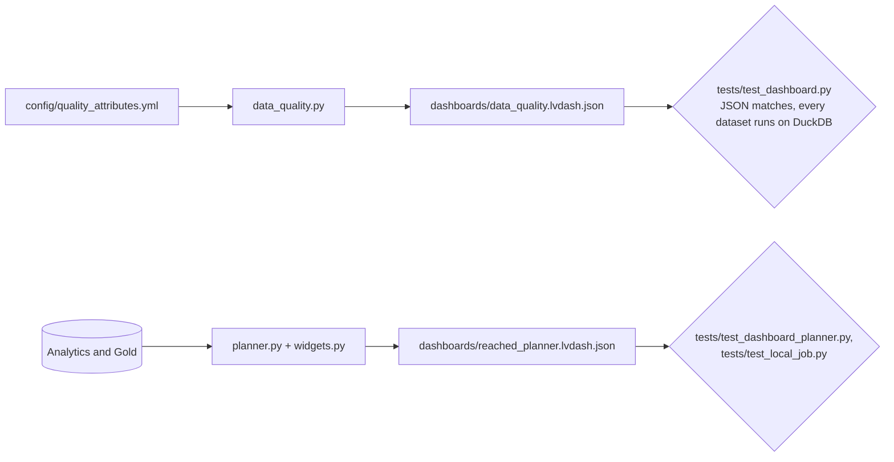

# Dashboard generators

Code that writes the AI/BI dashboard JSON under [`dashboards/`](../../dashboards/README.md), so the dashboard is reviewed as code and tested like the rest of the pipeline.

| Module | Writes | From |
|---|---|---|
| `data_quality.py` | `dashboards/data_quality.lvdash.json` | `config/quality_attributes.yml` and the control tables' columns |
| `planner.py` | `dashboards/reached_planner.lvdash.json` | The D-061 Analytics outputs, Gold, and `config/analytics_benchmarks.json` |
| `widgets.py` | Nothing on its own | The widget, filter, and page builders `planner.py` uses |

```bash
python -m src.dashboard.data_quality > dashboards/data_quality.lvdash.json
python -m src.dashboard.planner
```



The data-quality dashboard reads only `01-control`; the planner reads Analytics and Gold. What each page shows, its metrics, and its known limits are in the [dashboards README](../../dashboards/README.md).
