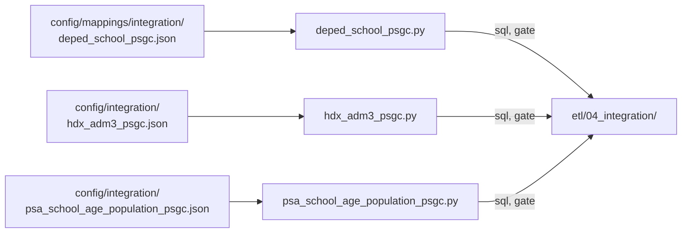

# Integration

Code that writes each mapping table's build and gate SQL from a reviewed rules file in `config/integration/`. The SQL is committed under `etl/04_integration/` and runs as two SQL tasks of the job.

The PSA poverty and annex maps have no generator; their SQL is written by hand in `etl/04_integration/`.

| Module | What it does |
|---|---|
| `deped_school_psgc.py` | DepEd school/year → PSGC city/municipality and barangay map (`deped_school_psgc_map`, #91, D-049): a reviewed override, the Special Geographic Area rule, the EMISD code, a reviewed name match, then explicit unmatched, ambiguous, or excluded. It matches distinct place tuples once for small-warehouse efficiency. `python -m src.integration.deped_school_psgc sql\|gate` |
| `hdx_adm3_psgc.py` | HDX ADM3 → PSGC crosswalk (`hdx_adm3_psgc_map`, #93, D-052): rules in #74's order, overrides, the build and the gate. `python -m src.integration.hdx_adm3_psgc sql\|gate` |
| `psa_school_age_population_psgc.py` | PSA school-age population places → PSGC (`psa_school_age_population_psgc_map`, #159, D-055): the parent from the reviewed regions and province aliases, names inside it by #154's tiers, overrides, the build and the gate. `python -m src.integration.psa_school_age_population_psgc sql\|gate` |
