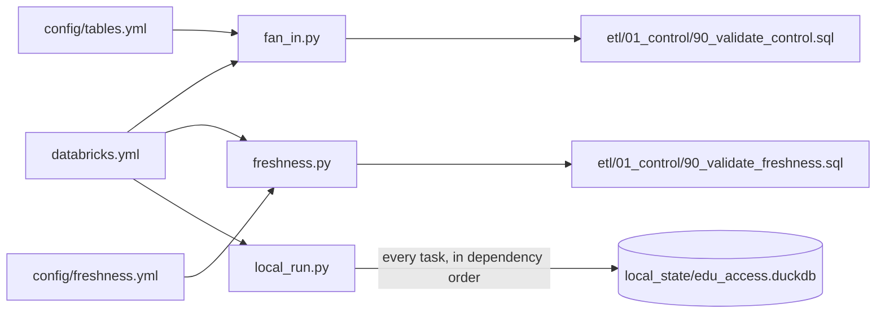

# Job

Code that reads the job in `databricks.yml`: two generators for control checks that must list every lane, and a runner that executes the whole job on a laptop.



| Module | What it does |
|---|---|
| `fan_in.py` | Generates `etl/01_control/90_validate_control.sql`, the source-lane fan-in, from `databricks.yml` and `config/tables.yml`: one check per Silver lane switched on, so a lane is never typed by hand or dropped (D-039). It is an audit: only freshness follows it (D-051). `python -m src.job.fan_in > etl/01_control/90_validate_control.sql`; `tests/test_fan_in.py` fails until the committed file matches |
| `freshness.py` | Generates `etl/01_control/90_validate_freshness.sql`, the source freshness check, from `databricks.yml` and `config/freshness.yml`: one check per Bronze load switched on, with its limit (D-043). `python -m src.job.freshness > etl/01_control/90_validate_freshness.sql`; `tests/test_freshness.py` fails until the committed file matches, or when a loaded source has no limit |
| `local_run.py` | Reads `databricks.yml` and runs the job's tasks one at a time, in dependency order, on the local DuckDB store: Python tasks through the same command line with local values, SQL tasks through `DuckDBStore` with the job parameters bound. Honours `run_if` |

```bash
RAW_DATA_DIR=~/Projects/reached-hq/raw-data python -m src.job.local_run
```

Tables go to `local_state/edu_access.duckdb` (git-ignored) unless `--db` says otherwise. Exit code 0 when every task succeeded, 1 otherwise. `tests/test_local_job.py` runs the job this way on made-up deliveries in CI.

| `local_run` option | Default |
|---|---|
| `--landing` | `RAW_DATA_DIR`: the raw data folder holding the publisher folders |
| `--db` | `local_state/edu_access.duckdb` |
| `--code-revision` | The local commit, with `-dirty` if there are uncommitted changes |
| `--job` | The only job in `databricks.yml` |
