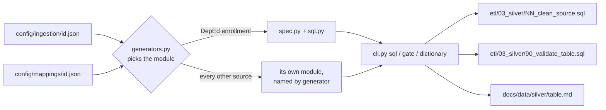

# Silver

Code that writes each source's Silver SQL from reviewed configuration. The SQL itself is in `etl/03_silver/` and runs as two SQL tasks of the job (`databricks.yml`): the build, into candidate tables, then the gate, which publishes them only if every check passes. Design: [docs/operations/silver.md](../../docs/operations/silver.md).



```bash
python -m src.silver.cli sql --source <source_id>
python -m src.silver.cli gate --source <source_id>
python -m src.silver.cli dictionary --source <source_id>
```

Each prints the file; redirect it to its path. Exit code 2 if the contract or mapping is invalid.

| Module | What it does |
|---|---|
| `spec.py` | Loads the Bronze contract and the Silver mapping (`config/mappings/<source_id>.json`) and classifies every publisher column (identifier, free text, category, boolean, count); stops on any column or label it cannot place |
| `sql.py` | Generates the build SQL (`NN_clean_<source>.sql`) and the gate (`90_validate_<table>.sql`) from the spec |
| `dictionary.py` | Generates the Silver data dictionary (`docs/data/silver/`) from the spec |
| `psa_poverty_stat.py` | PSA Poverty Stat's own spec, build, gate, and dictionary: unpivots the wide workbook rows to one row per unit and estimate year (D-034). `gate_checks()` lists every check the gate writes |
| `deped_personnel.py` | Personnel-specific typing, standard category labels, public-scope checks, publisher-versus-calculated principal totals, and the all-blank-field flag (D-041). `gate_checks()` lists every check the gate writes |
| `deped_facilities.py` | DepEd facilities' own spec, build, gate, and dictionary: count groups with their own maximums, sixty facility yes/no columns, and public-scope and offered-level warnings (D-038). `gate_checks()` lists every check the gate writes |
| `hdx_boundaries.py` | HDX ADM3's own spec, build, gate, and dictionary: dates, exact decimals, and geometry kept as published text and checked with spatial functions (D-040). `gate_checks()` lists every check the gate writes |
| `deped_enrollment_psgc.py` | The DepEd school-to-PSGC crosswalk's own spec, build, gate, and dictionary: one row per school from Bronze `unit` rows, codes padded to 10 digits with a reason where missing, Sulu recoded to 2Q 2026, coordinates typed and flagged (D-049). `gate_checks()` lists every check the gate writes |
| `deped_psgc_coordinates.py` | The public-only DepEd workbook's dictionary. Its build and gate are `deped_enrollment_psgc.py`'s, given a scope (SY 2023-24, `Public`): out-of-scope rows are quarantined with a reason, and the gate's `rows_in_scope` fails if a clean row leaves the scope (#217) |
| `psa_school_age_population.py` | PSA school-age population's own spec, build, gate, and dictionary: unpivots both census layouts to one row per place, sex and age, and recovers each place's level and parent from the sums, as the workbooks have no codes (D-053). `gate_checks()` lists every check the gate writes |
| `psa_psgc.py` | PSA PSGC's own spec, build, gate, and dictionary: one row per PSGC code per quarter, the income-class split, and the derived parent codes (D-035). `gate_checks()` lists every check the gate writes |
| `generators.py` | Chooses a source's generator: the module named by `generator` in its rules file, or the DepEd enrollment modules above |
| `cli.py` | `sql`, `gate`, `dictionary`: print a generated file. Exit code 2 if the contract or mapping is invalid |

Run the job, Silver included, locally on DuckDB:

```bash
RAW_DATA_DIR=~/Projects/reached-hq/raw-data python -m src.job.local_run
```
