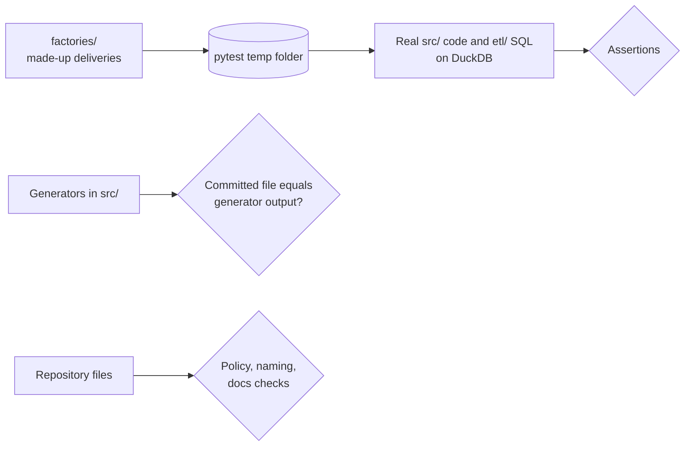

# Tests

The pytest suite CI runs on every pull request. It uses **made-up data only** and no credentials, and it runs the real pipeline code and SQL on DuckDB.

```bash
python -m pytest tests -q
```



## What is tested

| Group | Files | Checks |
|---|---|---|
| Ingestion | `test_ingestion_*.py` | Each delivery format: validation, loading, reruns, backfills, revisions, crash recovery |
| Silver | `test_silver*.py` | Each source's cleaning rules, quarantine, gate checks, publishing, and generated SQL |
| Integration | `test_integration_*.py`, `test_deped_school_psgc_rule.py` | Each PSGC map's rules, overrides, gate, and generated SQL; the DepEd matching rule on made-up units |
| Gold | `test_gold_*.py` | Each build and gate, run the way the job's two SQL tasks run them |
| Analytics | `test_analytics_*.py` | AP1 to AP4 and the D-057 priority table |
| Whole job | `test_local_job.py`, `test_bundle.py`, `test_databricks_runtime.py` | The job in `databricks.yml` run task by task, commit tracking, Databricks-only behavior imitated locally |
| Control and monitoring | `test_fan_in.py`, `test_freshness.py`, `test_alerts.py`, `test_dashboard.py` | Generated control SQL, the alert queries, the dashboard JSON and its datasets |
| Repository | `test_repo_policy.py`, `test_naming.py`, `test_config.py`, `test_documentation_structure.py`, `test_github_scripts.py`, `test_profiling_xlsx.py` | No data or secrets, naming, the source registry, documentation drift, workflow scripts, shared helpers |

Each file's docstring says exactly what it covers.

## Test inputs

| Folder | Holds |
|---|---|
| [`factories/`](factories/README.md) | Python builders for each delivery format; the default way to make an input |
| [`data/`](data/README.md) | Static made-up files, only when a factory is not practical; currently empty |

Tests must never depend on real source rows or credentials. A test that needs the real data belongs in `analysis/verification/` instead.
