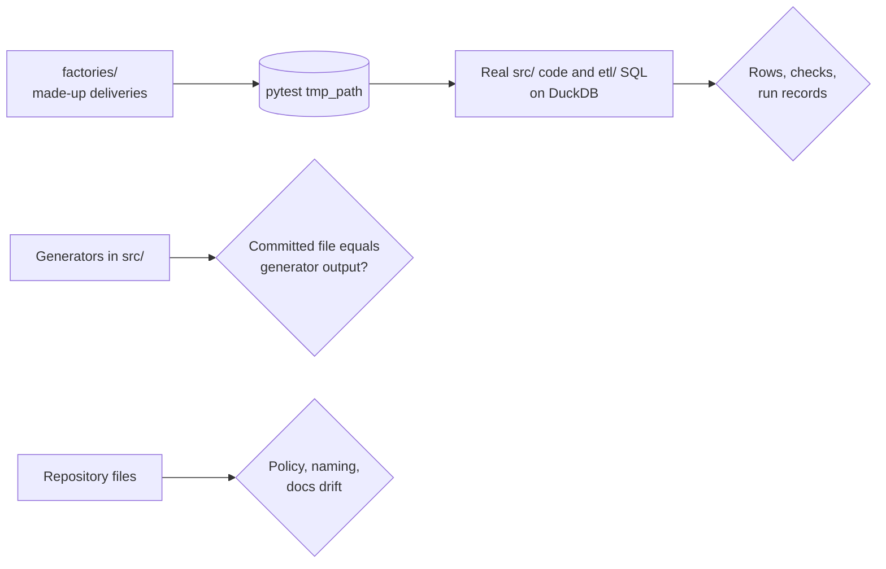
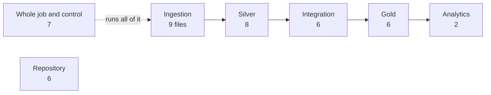

# Tests

The pytest suite CI runs on every pull request: about 1,200 tests in 44 files, about 3 minutes. It uses **made-up data only** and no credentials, and it runs the real `src/` code and `etl/` SQL on DuckDB, so a test exercises what the job runs.

## Running them

| Goal | Command |
|---|---|
| Everything, as CI does | `python -m pytest tests -q` |
| One layer | `python -m pytest tests/test_silver*.py -q` |
| One file | `python -m pytest tests/test_integration_hdx.py -q` |
| Tests whose name matches | `python -m pytest tests -q -k gate` |
| Stop at the first failure | `python -m pytest tests -q -x` |

## What each file covers

Each layer's tests follow the data through the pipeline. The docstring at the top of each file says exactly what it covers.

| Layer | Files |
|---|---|
| Ingestion | `test_ingestion_validate.py` (what a DepEd delivery must pass), `test_ingestion_pipeline.py` (idempotency, incremental loads, revisions, crash recovery), and one per source: `_facilities`, `_personnel`, `_psa`, `_psgc`, `_report` (EMISD), `_school_age`, `_boundaries` |
| Silver | `test_silver.py` (DepEd enrollment), `test_silver_facilities.py`, `_personnel`, `_psa`, `_psgc`, `_hdx`, `_school_age`, `_deped_enrollment_psgc` |
| Integration | `test_integration_deped_school_psgc.py`, `test_deped_school_psgc_rule.py` (the rule on made-up units), `test_integration_poverty.py`, `_hdx`, `_school_age`, `_annex` |
| Gold | `test_gold_dim_barangay.py`, `test_gold_dim_city_municipality.py`, `test_gold_dim_city_poverty.py`, `test_gold_fact_school_enrollment.py`, `test_gold_fact_city_population.py`, `test_gold_fact_city_school_age_population.py` |
| Analytics | `test_analytics_priority.py` (AP1 to AP4 and the D-057 tiers), `test_analytics_ap4.py` |
| Whole job and control | `test_local_job.py` (the whole job, task by task), `test_bundle.py` (commit tracking, task order), `test_databricks_runtime.py` (Databricks-only behavior imitated), `test_fan_in.py`, `test_freshness.py`, `test_alerts.py`, `test_dashboard.py` |
| Repository | `test_repo_policy.py` (no data or secrets, file size), `test_naming.py`, `test_config.py`, `test_documentation_structure.py`, `test_github_scripts.py`, `test_profiling_xlsx.py` |

`conftest.py` provides two fixtures: `repo_root` and `repo_files` (every file git would commit).

## Test inputs

| Folder | Holds |
|---|---|
| [`factories/`](factories/README.md) | Builders for each delivery format; the default way to make an input |
| [`data/`](data/README.md) | Static made-up files, only when a factory is not practical; empty today |

## Adding a test

- Put it in the file for its layer and source, or start `test_<layer>_<source>.py`.
- Build inputs with a factory; never read `RAW_DATA_DIR` or real rows. A check that needs the real data belongs in [`analysis/verification/`](../analysis/verification/README.md).
- For a gate, prove it fails: change one candidate row and assert the FAIL and that the published table is unchanged.
- For a generated file, compare the committed file with the generator's output.
