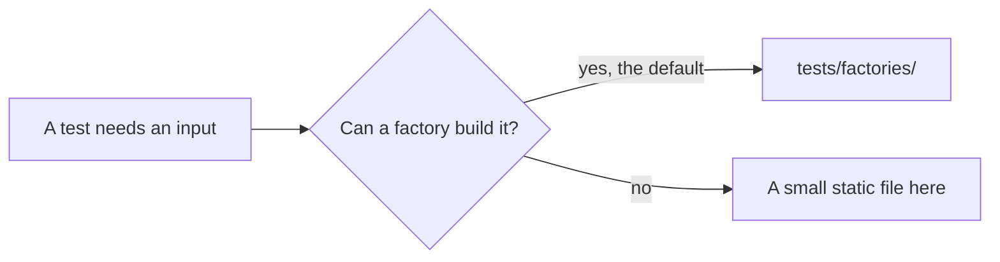

# Test data

**Empty on purpose.** Every test builds its input at run time with a factory in [`../factories/`](../factories/README.md), so no data file has been needed yet.

This folder stays because it is the one place a data file may ever be committed: `tests/test_repo_policy.py` fails on any `.csv`, `.xlsx`, `.zip`, `.geojson`, or other data file outside `tests/data/` (see [CONTRIBUTING.md](../../CONTRIBUTING.md#repository-rules)). Removing it would mean changing that rule.

Anything placed here must be small, static, and entirely made up. Real, transformed, or sampled publisher data must never be committed.
