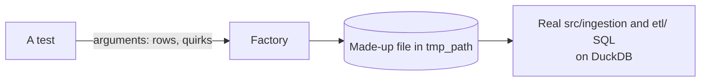

# Test factories

Python builders that make made-up deliveries, shaped exactly like each publisher's files, inside pytest's temporary folders. Nothing they write is committed. Every factory fixes its zip timestamps, so the same arguments always give the same SHA-256 and a test can approve the file in a made-up contract.

| Factory | Builds | Format | Used by |
|---|---|---|---|
| `deped_deliveries.py` | DepEd zips with one CSV and a README, from the real column contracts, with invented schools | `zip_csv` | Most tests: ingestion, Silver, Integration, Gold, Analytics, monitoring, and the whole job |
| `psa_workbooks.py` | PSA Poverty Stat workbooks: title, merged header, region banners, `Notes:` footer, one of each known quirk; places from ID 99xxx | `xlsx_sheet` | `test_ingestion_psa.py`, `test_silver_psa.py`, `test_local_job.py` |
| `psgc_workbooks.py` | PSA PSGC workbooks with all six sheets and the publisher's header; invented regions `00` and `20` | `xlsx_table` | `test_ingestion_psgc.py`, `test_silver_psgc.py`, `test_local_job.py` |
| `report_workbooks.py` | DepEd EMISD workbooks: five title rows, header in row 8, and one of each profiled quirk (lost leading zeros, `#N/A`, a repeated school, mojibake) | `xlsx_report` | `test_ingestion_report.py`, `test_silver_deped_enrollment_psgc.py`, `test_local_job.py` |
| `census_workbooks.py` | PSA school-age population workbooks: 2020 wide and 2024 long layouts, two sheets each, with the flagged quirks | `xlsx_census` | `test_ingestion_school_age.py`, `test_silver_school_age.py`, `test_local_job.py` |
| `hdx_geojson.py` | COD-AB GeoJSON with invented places (codes from PH99) and a small polygon, written by hand so a test can check exact characters (`112.2460` stays `112.2460`) | `geojson_features` | `test_ingestion_boundaries.py`, `test_silver_hdx.py`, `test_local_job.py` |

A new delivery format gets a factory here before its first test. Copy the real file's shape from the source's profile, never its rows.
